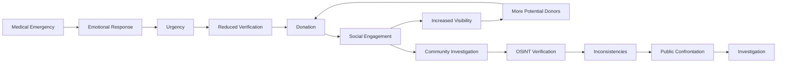
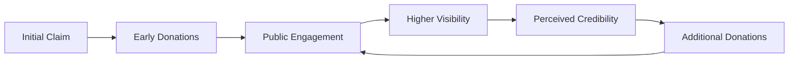
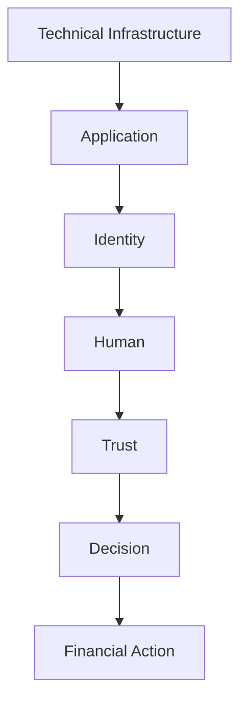
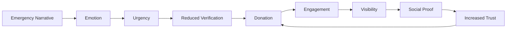
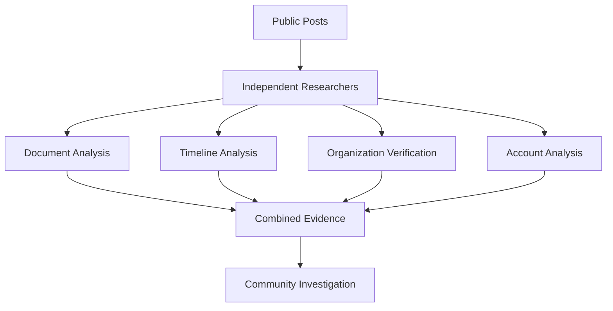

A fabricated medical emergency reportedly raised more than ₹1.5 lakh on X before inconsistencies in the story and supporting documents triggered a public investigation. What makes the incident interesting from a cybersecurity perspective is that there was no malware, exploit, or compromised server involved. The primary attack surface was human trust.

## Incident Overview

In September 2026, an X account using the name **Jay Singh Rathore** published an emotional crowdfunding appeal claiming that his sister urgently required medical treatment.

The campaign combined an urgent medical narrative, supporting documents, payment information, and social media engagement. The story gained traction quickly, and reports stated that approximately ₹1.5 lakh was collected before users began questioning the authenticity of the claims and documents.

The controversy eventually moved into public X Spaces, where the account holder was questioned by users about inconsistencies in the story.

The incident later resulted in police action over allegations involving fraudulent fundraising and forged medical documentation.

From a security perspective, the interesting part is not simply that people donated money. It is how the campaign constructed enough credibility for strangers to voluntarily make financial transactions.

## Social Engineering Attack Surface

The technical attack surface was relatively small.

The human attack surface was much larger.

The campaign relied on several components working together:



The payment mechanism itself did not need to be compromised.

The victim authorized the transaction voluntarily.

That distinction matters. A technically secure payment system cannot prevent a user from sending money when the user has been convinced that the transaction is legitimate.

## How the Story Established Trust

The campaign did not depend on a single deception technique. It combined several psychological signals that reinforced each other.

### Emotional Manipulation

The core of the campaign was a medical emergency involving a family member.

Medical emergencies naturally create strong emotional reactions. When people believe that someone's health is at immediate risk, they are more likely to prioritize helping over verification.

This creates a useful condition for a social engineer:

**Emotion reduces verification.**

A donor who normally checks a website, verifies an identity, or questions a payment request may skip those steps when they believe someone's treatment is urgent.

### Urgency

The campaign was presented as time-sensitive.

Urgency is particularly effective because it changes the user's decision-making process. Instead of asking whether the claim is legitimate, the user starts asking whether they can afford to wait.

The psychological decision becomes:

```text
Verify first
    vs.
Help immediately
```

When the second option is framed as potentially affecting someone's health, verification can feel morally wrong even when it is exactly what should happen.

### Fabricated Authority

Medical documents added another layer of credibility.

A document containing a hospital name, medical terminology, dates, and treatment information can appear authoritative to someone who has no way to independently validate it.

This is where an important security principle applies:

**Finding a document is not the same as verifying a document.**

The document has to be treated as an untrusted input until its authenticity can be established.

### Social Proof

Once the campaign started receiving attention, engagement itself became another credibility signal.

People naturally use the behavior of others as evidence.

If a campaign has already received donations, reposts, comments, and public support, a new viewer may assume that somebody else has already verified it.

That creates a feedback loop:



The interesting part is that the platform does not need to explicitly endorse the campaign.

The audience can create the appearance of legitimacy themselves.

## OSINT Investigation

The eventual exposure demonstrates how publicly available information can be used to challenge a fraudulent claim.

No privileged access is required to begin this type of investigation.

The first step is to separate the **claim** from the **evidence supporting the claim**.

### Document Verification

A suspicious medical document can be examined for several indicators:

- Hospital name and contact information
- Doctor credentials
- Dates and timestamps
- Formatting inconsistencies
- Spelling and terminology
- Registration or reference numbers
- Logos and letterheads
- Metadata, when available
- Differences between multiple documents

None of these checks should be treated as definitive on its own.

Metadata can be removed or modified. Formatting can be copied. Names and logos can be reproduced.

The objective is to build a collection of independent signals.

### Independent Verification

One of the most important OSINT principles in a case like this is **independent verification**.

If the person making the claim provides a phone number or website for verification, that information should not automatically be trusted.

Instead:

```text
Claim
  |
  v
Identify the organization
  |
  v
Find its official website independently
  |
  v
Obtain official contact information
  |
  v
Verify the claim through an independent channel
  |
  v
Compare the result with the original evidence
```

This prevents the investigation from becoming circular.

Asking the person who supplied the evidence whether their own evidence is legitimate does not provide independent verification.

### Timeline Analysis

Another useful technique is comparing statements over time.

A single statement can appear plausible when viewed in isolation.

Contradictions become much easier to identify when statements are placed on a timeline.

For example:

```text
Statement A
The money is required for a sister's emergency surgery.

        |
        v

Statement B
The medical situation differs from the original description.

        |
        v

Statement C
The funds were actually related to another family member.
```

The important signal is not simply that one statement appears suspicious.

It is that the explanation changes as scrutiny increases.

## Red Flags

Several indicators made the campaign worth investigating.

| Indicator | Why it matters |
| --- | --- |
| Emergency medical claim | Creates strong emotional pressure |
| Immediate financial requirement | Reduces time available for verification |
| Medical documentation | Creates perceived authority |
| Rapid viral growth | Creates social proof |
| Weak identity verification | Makes accountability harder |
| Changing explanations | Creates contradictions |
| Independent organization dispute | Provides external evidence against the claim |
| Pressure to donate quickly | Discourages investigation |

None of these indicators alone proves fraud.

The useful concept is **signal aggregation**.

One unusual detail can have an innocent explanation. Multiple independent inconsistencies require much more scrutiny.

## Trust as an Attack Vector

Traditional security assessments focus heavily on technical assets.

We look for:

- Exposed services
- Vulnerable applications
- Leaked credentials
- Broken authentication
- API authorization issues
- Cloud misconfigurations
- Sensitive data exposure

Social engineering attacks a different layer.



The attacker does not necessarily need to bypass a security control.

They can convince the legitimate user to perform the action themselves.

This is why strong technical controls do not eliminate social engineering risk.

The payment system can correctly authenticate the user.

The user can still make a fraudulent payment.

## Why the Campaign Worked

The campaign combined several mechanisms instead of relying on one deception.



This creates a self-reinforcing cycle.

The more attention the story receives, the more legitimate it can appear.

The more legitimate it appears, the more people are willing to contribute.

This means social media amplification can become part of the attack mechanism itself.

It is not simply a distribution channel.

## Community-Driven Detection

The same platform that amplified the campaign also helped expose inconsistencies.

Different users noticed different anomalies.

One person could identify a suspicious document.

Another could check the hospital.

Another could compare previous posts.

Another could track changes in the story.

Individually, these observations may not be enough.

Together, they create a much stronger investigative picture.

This is effectively **distributed OSINT analysis**.



There is an important boundary here.

OSINT should remain focused on verification.

Researchers should not:

- Publish private addresses
- Expose phone numbers
- Publish financial account details
- Harass relatives
- Attempt unauthorized access
- Dox suspected individuals
- Fabricate evidence

The objective is to establish what happened using lawful and publicly available information.

## The Security Lesson

The most important lesson from this incident is not that people can be manipulated.

That is already well understood in cybersecurity.

The more interesting lesson is that **social media itself can function as an environment for social engineering**.

An attacker can combine:

- Identity
- Narrative
- Documents
- Emotion
- Reputation
- Social proof
- Platform amplification
- Payment infrastructure

to construct a convincing fraud without deploying traditional malware.

The attack happens at the human layer.

## Defensive Thinking

The usual security awareness advice is:

> "Do not click suspicious links."

That is useful, but it does not cover this class of attack.

A better model is to ask:

```text
Who is making the claim?

        |
        v

What evidence supports it?

        |
        v

Can the evidence be independently verified?

        |
        v

Is urgency preventing verification?

        |
        v

What is the impact if the claim is false?
```

This model is useful beyond crowdfunding.

The same reasoning applies to fake job offers, impersonation, investment scams, account recovery requests, donation campaigns, and other forms of social engineering.

## Closing

The **Scam 2026** incident shows that the strongest attack vector is sometimes not a vulnerability in software.

It is trust.

No zero-day is required when a convincing narrative can persuade someone to act. No malware is required when the victim willingly authorizes the transaction. No privileged access is required when publicly available information can be used to construct credibility.

For security researchers, this is a reminder that the attack surface extends beyond infrastructure.

**Sometimes the system being attacked is the human decision-making process.**

And the most effective defensive control in that environment is simple:
**Verify before you trust.**

## References

- https://www.hindustantimes.com/trending/why-is-jay-singh-rathore-trending-5-things-about-the-alleged-rs-1-5-lakh-scam-on-x-101790125334003.html
- https://m.economictimes.com/news/new-updates/whos-jay-singh-rathore-why-is-he-trending-on-x-vijay-mallya-jokes-best-twitter-moment-memes-explode-on-social-media/articleshow/134426017.cms
